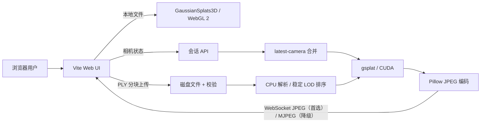

# 技术架构

## 两条渲染路径

浏览器本地模式支持 `.ply`、`.splat`、`.ksplat` 和 `.spz`，文件不离开用户设备。服务端模式目前接收标准 binary little-endian 3DGS PLY；服务进程解析并验证参数，把模型常驻一张指定 GPU，由 gsplat 完成光栅化。

## 服务端帧流

客户端创建 `/api/session` 后优先升级到双向 WebSocket：文本消息发送相机状态，二进制消息接收 `stats + JPEG`。相机消息带递增 `client_seq`，服务端随渲染帧确认；浏览器最多保留 2 个未确认视角，待发状态始终覆盖为最新值。这样既避免逐请求 RTT，又避免有序 TCP 中积压过期视角。WebSocket 不可用时回退到 `multipart/x-mixed-replace` MJPEG，并通过 POST 更新相机。

两种协议都只渲染新 revision。MJPEG 在停止后仅补发一次已编码帧以提交 Chromium 缓冲，并探测空闲 socket 断开；WebSocket 不需要重复帧。默认最多 4 个会话、120 秒无流连接自动回收。各渲染调用从 CUDA stream 池取独立 stream，只有模型加载/更换持有全局互斥。

## 当前 LOD

模型加载时使用 `opacity × max(scale)²` 作为与视角无关的重要性近似，只排序一次。三个 LOD 是同一数组的稳定前缀：

- `preview`：25%，供 API 客户端或高斯加载量滑杆选择。
- `balanced`：55%，供 API 客户端选择。
- `full`：100%，网页滑杆默认值。

网页请求使用 `lock_lod=true`：高清模式在旋转和静止时都使用 1280×720，性能模式都使用 800×450；Gaussian 数始终等于 10%–100% 滑杆的明确选择。服务端不得根据 `interactive` 改变点集。未锁定 LOD 的自定义 API 客户端仍可使用帧预算自动升降档。

稳定前缀避免 LOD 切换时随机闪烁，也避免每帧生成 GPU 索引数组。它能减少光栅工作集和传输带宽，但不会减少完整模型的常驻显存，这是它与空间流式 LOD 的关键区别。

## 负载控制

- `CUDA_VISIBLE_DEVICES` 固定物理 GPU，避免误用其他卡。
- `torch.cuda.set_per_process_memory_fraction` 设置进程上限。
- 加载和渲染前检查剩余显存；捕获 CUDA OOM 并清理缓存。
- PLY 校验长度、字段、有限值和尺度语义，阻止异常 Gaussian 放大 tile buffer。
- 会话数有硬上限，所有相机 JSON 和上传文件均有限制。
- 上传以 4 MiB 块写盘，不在 HTTP 层复制整个文件。
- 浏览器本地渲染依赖动态导入，服务端模式首屏只下载 UI 主包。

## 部署边界

当前 HTTP 服务采用 Python 标准库，适合隔离容器内验证。公网部署应在它前面增加 TLS 反向代理、认证、上传限速、请求体限制和审计；当前 `Access-Control-Allow-Origin: *` 与无鉴权配置仅适用于受控测试网络。

每个 GPU 建议运行一个渲染 worker，由独立调度层做会话亲和性和 admission control。不要简单增加同卡 worker 数量：每个 CUDA 进程都有上下文开销，且并发光栅化可能造成尾延迟和 OOM。

## API 摘要

| 方法 | 路径 | 用途 |
| --- | --- | --- |
| GET | `/health`, `/api/status` | GPU、模型、能力与会话状态 |
| POST | `/api/model` | 原始请求体上传标准 PLY |
| POST | `/api/render` | 单次 JPEG 渲染，兼容与高清截图 |
| POST | `/api/session` | 创建交互会话并提交初始相机 |
| GET | `/api/session/{id}/ws` | 双向 WebSocket 相机控制与 JPEG 帧流 |
| POST | `/api/session/{id}/camera` | 更新最新相机、分辨率和 LOD |
| GET | `/api/session/{id}/stream` | MJPEG 帧流 |
| GET | `/api/session/{id}` | 最近一帧指标 |
| DELETE | `/api/session/{id}` | 主动释放会话 |
