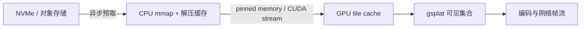

# 大规模 3DGS 渲染路线

## 已经解决的问题

当前版本已经解决“每次拖动都建立完整图片请求并让旧帧排队”的交互卡顿：浏览器优先使用双向 WebSocket，客户端只保留最新待发视角并把未确认视角限制为 2 个；服务端在帧统计中回传 `client_seq`，形成应用层背压。网页端同时使用 `lock_lod=true`，旋转与静止保持相同分辨率、JPEG 质量和 Gaussian 集合，避免交互时隐式降 LOD 造成场景组成部分消失；WebSocket 不可用时保留 MJPEG 降级路径。
服务端仍保留自适应帧预算：未锁定的自定义客户端可按 `FRAME_BUDGET_MS` 自动升降 LOD；网页用户则通过质量选择器和 10%–100% 高斯加载量滑杆显式取舍完整度与帧率。真正的城市级场景仍需下面的 out-of-core 分块与代理 LOD，不能重新依赖随机/前缀删点来掩盖负载。
第二轮已实现三项：多会话 CUDA stream 并发（渲染路径去掉全局锁，流池按会话上限配置，A5000 实测相机 50ms 更新下单会话 19.6 fps、双会话各 19.3 fps、四会话各 18.9 fps，无头程阻塞）；空间 LOD（加载时按二分网格分组，1.16M 点 → 4096 叶，每帧视锥裁剪 + 投影尺寸贪心，25% 预算下选择 1.05 ms、选 297K 点，近景自动剔除视外叶）；客户端混合渲染（服务端导出 25% 粗模 `.splat`，前端叠加画布在拖动时本地即时预览，服务端帧到达即淡出）。


## 尚未解决的硬边界

完整模型仍被解析到 CPU 后一次性复制进 GPU：空间 LOD 改进了每帧选点策略（近处细节优先），但常驻显存占用不变，不能加载大于 GPU 常驻预算的完整世界模型。千万至亿级场景必须改为 out-of-core 空间流式方案，不能只提高 `MEMORY_FRACTION`。

## 推荐的空间流式格式

离线预处理器应把标准 PLY 转成项目专用目录或单文件容器：

```text
scene.gsmeta                 # 版本、坐标系、全局包围盒、SH 阶数
nodes.bin                    # 扁平化八叉树 / Morton 节点表
chunks/xx/xxxxxxxx.gsbin     # 内容寻址、量化并压缩的 Gaussian 块
```

每个树节点保存包围盒、几何误差、Gaussian 数、压缩字节数、子节点范围和一个可独立渲染的代理 LOD。叶块建议控制在 2–8 MiB，使磁盘读取、网络传输和 GPU 上传都可取消并有明确预算。位置可按节点包围盒量化，rotation/scale/opacity/color 按可接受误差量化；SH 高频系数可随 LOD 延迟加载。

## 每帧选择算法

1. 从根节点开始做视锥裁剪。
2. 估算节点在屏幕上的投影误差；小于阈值时渲染当前代理，否则遍历子节点。
3. 按 `屏幕误差收益 / 预计字节` 排序，在 Gaussian 数、显存和帧时间三重预算内选择节点。
4. 对进入/离开的节点设置滞回区间，并让父子 LOD 短暂交叉淡化，避免视角轻微变化导致闪烁。
5. 复用上一帧集合，只增量上传变化的 tile。

不要只按相机距离选 LOD：狭长场景、超大尺度 Gaussian 和不同 FOV 下都会失真。屏幕空间误差和实际投影半径更稳定。

## 三级缓存



- 磁盘层使用内容哈希与顺序布局，支持 Range 请求和断点恢复。
- CPU 层使用 mmap、固定总字节 LRU，并给当前视锥与预测视锥更高优先级。
- GPU 层按字节预算缓存 tile，使用引用计数避免驱逐正在渲染的块；上传走独立 CUDA stream。
- 当新 tile 未到达时继续使用父级代理，不能让画面出现空洞。

## 网络传输选择

当前 WebSocket JPEG 的优点是单连接双向、无需新增依赖、每帧独立且 latest-state 背压容易实现；MJPEG 作为兼容降级。二者都仍发送独立 JPEG，带宽和 CPU 编码会随帧率、分辨率及用户数线性增加。公网多用户建议增加 WebRTC：相机控制走 DataChannel，视频走低延迟编码，利用拥塞控制动态调整码率和分辨率。是否使用 NVENC 等硬件编码必须先检测实际 GPU 型号、宿主机驱动和容器权限，不能假设所有 V100/A5000 环境都可用。

模型 tile 流和服务端视频流是两种不同模式：服务端渲染用户只需要视频；未来高性能桌面用户可以直接接收可见 tile 并在浏览器渲染。二者可共用同一份空间索引和缓存服务。

## 建议实施顺序

1. 采集真实大场景数据：Gaussian 数、空间分布、最大投影半径、目标分辨率和并发用户数。
2. 实现 `build_scene_index.py`：八叉树、代理 LOD、量化 chunk 和 manifest 校验。
3. 实现单会话 CPU mmap + GPU tile cache，先保持现有 WebSocket JPEG / MJPEG 协议。
4. 加入帧时间控制器，让 LOD 阈值根据最近 P50/P95 GPU 时间自动收敛。
5. 再做多 GPU 调度、WebRTC 和公网安全层；这时才进行并发容量测试。

下一阶段最需要共同确认的三个输入是：目标最大 Gaussian 数、典型场景的空间尺度/是否城市级、以及同时在线用户数。它们直接决定八叉树深度、tile 大小、GPU 缓存预算和传输协议。
