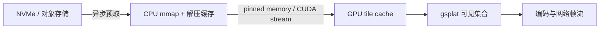

# 大规模 3DGS 渲染路线

## 当前可用的集成方案

浏览器侧 out-of-core 已落地：页面的“大场景流式”模式使用 Spark 2.4 读取预构建 `.RAD` LoD 树与 `.RADC` chunk，按相机视锥和屏幕误差分页加载，并用固定大小的共享 LRU page pool 控制浏览器显存。它可以直接消费 CityGS/Spark 生态生成的资源，不需要修改 `citygs-spark-docker`。这条路径适合高性能用户终端和城市级交互浏览。

## 当前规模分流决策

| 输入规模/场景 | 默认路径 | 原因 |
|---|---|---|
| 数十万至约 2M（按设备内存动态为 1M/2M/3M） | 浏览器直接 WebGL | 百万点在 GTX 1650 Ti 连续三次实测 73.5–74.2 FPS；无网络帧传输 |
| 超过直接阈值、约 30M 以内的一次性本地文件 | Spark 浏览器 Web Worker 现场 LoD | 用户可直接选 PLY/SPZ，无服务端转换；但仍需完整读取源文件 |
| 千万点以上、城市级、重复发布 | 预构建 RAD/RADC 分页 | HTTP Range 按视角取块，固定 4M/8M 工作集，场景总量不受浏览器显存直接约束 |
| 无 WebGL/弱终端 | gsplat + WebRTC/H.264 服务端帧流 | GPU 集中渲染；视频轨带拥塞控制，模型当前仍完整常驻 GPU |

现场 LoD 是易用入口，不等同于 out-of-core。真正“任意总规模”需要离线空间索引、父级代理 LoD、可独立解码块和固定字节预算缓存；本项目当前以 Spark RAD/RADC 完成浏览器侧这条链路。

需要区分两种“流式”：

- **模型分页流**：`.RAD/.RADC → 浏览器 WebGL`，场景总量可远大于显存，画质和交互由用户设备承担；本仓库现已实现。
- **服务端画面流**：`PLY → CUDA/ROCm gsplat → WebRTC/H.264`，适合低配置客户端；模型目前仍需完整常驻 GPU。

## 已经解决的问题

当前版本已解决“每次拖动都建立完整图片请求并让旧帧排队”的卡顿：浏览器用 WebSocket 持续覆盖最新相机状态，服务端以 WebRTC/H.264 latest-frame 视频轨返回画面；控制与视频分离，RTP 拥塞不会阻塞相机。移动阶段使用稳定的 550K（性能模式 300K）绝对点预算，停止后恢复滑杆指定点数。WebRTC 不可用时保留 H.264/fMP4、JPEG WebSocket 和 MJPEG 降级路径。
服务端仍保留自适应帧预算：未锁定的自定义客户端可按 `FRAME_BUDGET_MS` 自动升降 LOD；网页用户则通过质量选择器和 10%–100% 高斯加载量滑杆显式取舍完整度与帧率。浏览器城市级场景已可使用 `.RAD/.RADC`；若要求 Python 服务端统一渲染，仍需下面的 out-of-core 分块与代理 LOD，不能重新依赖随机/前缀删点来掩盖负载。
第二轮已实现三项：多会话 CUDA stream 并发（渲染路径去掉全局锁，流池按会话上限配置，A5000 实测相机 50ms 更新下单会话 19.6 fps、双会话各 19.3 fps、四会话各 18.9 fps，无头程阻塞）；空间 LOD（加载时按二分网格分组，1.16M 点 → 4096 叶，每帧视锥裁剪 + 投影尺寸贪心，25% 预算下选择 1.05 ms、选 297K 点，近景自动剔除视外叶）；客户端混合渲染（服务端导出 25% 粗模 `.splat`，前端叠加画布在拖动时本地即时预览，服务端帧到达即淡出）。


## 服务端路径尚未解决的硬边界

Python/gsplat 服务端仍把完整模型解析到 CPU 后一次性复制进 GPU：空间 LOD 改进了每帧选点策略（近处细节优先），但常驻显存占用不变，不能加载大于 GPU 常驻预算的完整世界模型。需要服务端统一算力的千万至亿级场景仍应实现下述 tile cache；如果允许终端 WebGL，优先直接使用已经落地的 Spark 分页模式。

## 服务端后续推荐的空间流式格式

离线预处理器应把标准 PLY 转成项目专用目录或单文件容器：

```text
scene.gsmeta                 # 版本、坐标系、全局包围盒、SH 阶数
nodes.bin                    # 扁平化八叉树 / Morton 节点表
chunks/xx/xxxxxxxx.gsbin     # 内容寻址、量化并压缩的 Gaussian 块
```

每个树节点保存包围盒、几何误差、Gaussian 数、压缩字节数、子节点范围和一个可独立渲染的代理 LOD。叶块建议控制在 2–8 MiB，使磁盘读取、网络传输和 GPU 上传都可取消并有明确预算。位置可按节点包围盒量化，rotation/scale/opacity/color 按可接受误差量化；SH 高频系数可随 LOD 延迟加载。

## 每帧选择算法

1. 从根节点开始做视锥裁剪。
2. 估算节点在屏幕上的投影误差；小于阈值时渲染当前代理，否则遍历子节点。
3. 按 `屏幕误差收益 / 预计字节` 排序，在 Gaussian 数、显存和帧时间三重预算内选择节点。
4. 对进入/离开的节点设置滞回区间，并让父子 LOD 短暂交叉淡化，避免视角轻微变化导致闪烁。
5. 复用上一帧集合，只增量上传变化的 tile。

不要只按相机距离选 LOD：狭长场景、超大尺度 Gaussian 和不同 FOV 下都会失真。屏幕空间误差和实际投影半径更稳定。

## 三级缓存



- 磁盘层使用内容哈希与顺序布局，支持 Range 请求和断点恢复。
- CPU 层使用 mmap、固定总字节 LRU，并给当前视锥与预测视锥更高优先级。
- GPU 层按字节预算缓存 tile，使用引用计数避免驱逐正在渲染的块；上传走独立 CUDA stream。
- 当新 tile 未到达时继续使用父级代理，不能让画面出现空洞。

## 网络传输选择

当前相机控制走 WebSocket，画面优先走 aiortc WebRTC/H.264，并保留 H.264/fMP4、JPEG WebSocket 与 MJPEG 三级降级。RX 7700 XT 当前使用 libx264 软件编码；若后续接入 VAAPI/NVENC，必须先检测驱动、FFmpeg/PyAV 编码器和容器设备权限。

模型 tile 流和服务端视频流是两种不同模式：服务端渲染用户只需要视频；高性能桌面用户现在已经可以通过 `.RAD/.RADC` 接收可见 tile 并在浏览器渲染。若未来实现服务端 tile cache，可以评估复用 RAD 元数据，避免维护两套离线索引。

## 建议实施顺序

1. 采集真实大场景数据：Gaussian 数、空间分布、最大投影半径、目标分辨率和并发用户数。
2. 实现 `build_scene_index.py`：八叉树、代理 LOD、量化 chunk 和 manifest 校验。
3. 实现单会话 CPU mmap + GPU tile cache，并保持现有 WebRTC 与兼容降级协议。
4. 加入帧时间控制器，让 LOD 阈值根据最近 P50/P95 GPU 时间自动收敛。
5. 再做多 GPU 调度、硬件视频编码和公网安全层；这时进行并发容量测试。

下一阶段最需要共同确认的三个输入是：目标最大 Gaussian 数、典型场景的空间尺度/是否城市级、以及同时在线用户数。它们直接决定八叉树深度、tile 大小、GPU 缓存预算和传输协议。
